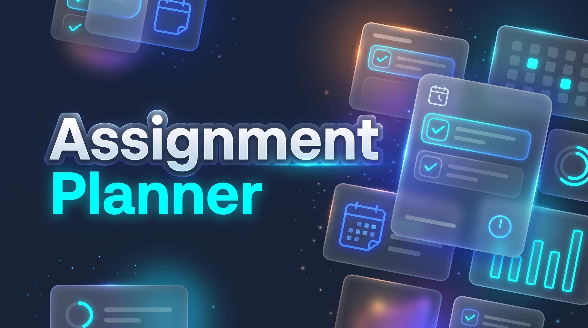

# Assignment Planner (Android) – PoE Part 3

[](https://github.com/your-username/assignment-planner/actions/workflows/build.yml)
**Student Name:** Mlondi Shezi  
**Student Number:** ST10458040  
**Module:** Open Source Coding (Intermediate) – OPSC6312  
**Institutional Affiliation:** The Independent Institute of Education (IIE) / Rosebank College  
**Final Submission Tag:** `final-poe`  
**Demonstration Video Link:** [ https://youtu.be/shfwovqlF50?si=EVhUQBH6oOow838Y ]  

---

## 1. Project Overview & Problem Statement
Tertiary students juggle heavy course loads, simultaneous assignment deliverables, and shifting test dates across diverse academic faculties. Generic to-do apps lack academic context (module coding, weighted evaluations, credit frameworks), while complex enterprise planners have steep learning curves and require constant internet connectivity.

**Assignment Planner** is an offline-first Android application designed specifically for higher education students. Built with an intuitive dark-mode aesthetic, dynamic gamification, and bilingual localization (English & isiZulu), it guarantees students can track, schedule, break down, and sync their academic workloads seamlessly with or without network access.

---

## 2. Architecture & Tech Stack

The application follows an **Offline-First MVVM (Model-View-ViewModel)** layered architecture utilizing the Android XML View System for layout rendering and system lifecycle stability.

```
┌────────────────────────────────────────────────────────┐
│               UI Layer (XML + ViewBinding)             │
│   Activities, BaseActivity (Locale/Theme), Adapters    │
└───────────────────────────┬────────────────────────────┘
│
┌───────────────────────────▼────────────────────────────┐
│                      Logic Layer                       │
│    ViewModels, AppPreferences, Repositories, Workers   │
└─────────────┬────────────────────────────┬─────────────┘
│ Local                      │ Remote
┌─────────────▼──────────────┐ ┌───────────▼─────────────┐
│      Room SQLite DB        │ │    Cloud Firestore      │
│  (Offline-First Store &    │ │    (NoSQL Cloud DB)     │
│    SyncRecord Queue)       │ │                         │
└────────────────────────────┘ └───────────┬─────────────┘
│
┌───────────▼─────────────┐
│ Firebase Authentication │
│  (Email/Pass & SSO)     │
│ Firebase Cloud Storage  │
│  (Blob Profile Assets)  │
│ Firebase Cloud Messaging│
│  (FCM Push Alerts)      │
└─────────────────────────┘
```

- **Platform:** Android SDK (API 26 to 34+), Kotlin
- **UI Framework:** Android XML View System, Material Design 3, ViewBinding, Custom Shape Drawables
- **Local Persistence:** Room Database (SQLite) with transactional `SyncRecord` queuing
- **Cloud Backend:** Cloud Firestore (NoSQL), Node.js / Firebase REST API
- **Authentication:** Firebase Authentication (Email/Password & Google Single Sign-On via Credential Manager)
- **Blob Storage:** Firebase Cloud Storage (PDF rubrics and profile avatar images)
- **Notifications:** Firebase Cloud Messaging (FCM) & Android `AlarmManager` for precise deadline study chimes
- **Background Tasks:** Android Jetpack `WorkManager` for asynchronous delta synchronization

---

## 3. Rubric Feature Implementation

| Feature | Marks | Technical Implementation |
| :--- | :---: | :--- |
| **Physical Device Execution** | 5 | Fully optimized, tested, and demonstrated on physical Android hardware. |
| **Authentication & SSO** | 10 | Firebase Authentication supporting email/password credential hashing and Google Single Sign-On (SSO). |
| **Settings & Localization** | 10 | Dynamic runtime switching between English (SA) and isiZulu (`zu`), plus AMOLED, Atmospheric, and Light themes via `BaseActivity` context wrapping. |
| **REST API & Cloud Data** | Part 1 | Firestore NoSQL persistence isolated per user with HTTPS REST API communication. |
| **Offline Mode & Sync** | 10 | Local Room DB write-first strategy; pending operations logged in `SyncRecord` queue and resolved via `SyncWorker`. |
| **Push Notifications** | 10 | Firebase Cloud Messaging (FCM) alerts and immediate local notification channel dispatch for task events. |
| **User Defined 4 (Innovative)** | 10 | **Deadline-Risk Engine:** Dynamic visual flags (`On Track`, `Due Soon`, `Overdue`) color-coded by priority (Green, Blue, Red). |
| **User Defined 5 (Innovative)** | 10 | **Study Velocity & Gamification:** Consecutive day streaks, accumulated XP calculations, and 48-hour cluster deadline alerts. |
| **UI & Defect Handling** | 10 | Dark glassmorphic design system, non-crashing input validation, and empty state fallbacks. |
| **Play Store Preparation** | 5 | Production keystore signing, release APK build, and Play Console listing documentation. |
| **GitHub CI/CD & Testing** | 10 | Clean Git history, `final-poe` tag, unit test suite, and automated GitHub Actions workflow. |
| **Video Demonstration** | 5 | Voice-over demonstration showing offline transitions, database persistence, and bilingual features. |
| **AI Tool Write-up** | 5 | Documented in Section 9 of the Process Document and cited in Harvard style. |

---

## 4. Signed Release Build & Play Store Readiness

The application has been prepared for distribution following Google Play standards:

- **Application ID:** `com.example.assignmentplanner`
- **Version Code:** `1`
- **Version Name:** `1.0.0`
- **Signing Scheme:** V2 & V3 Full APK Signature
- **Keystore Algorithm:** RSA 2048-bit (SHA-256 with RSA)
- **Artifact Output:** `app/release/app-release.apk`

### Keystore Configuration (Kept Secure & Local)
```text
Alias: planner_key
Validity: 25 Years
Certificate Issuer: CN=Mlondi Shezi, C=ZA
```

### Store Listing Artifacts
- **App Icon:** 512 × 512 px high-resolution launcher icon
- **Feature Graphic:** 1024 × 500 px promotional banner
- **Target Audience:** Tertiary Students (18+)
- **Content Rating:** Everyone / PEGI 3 (Productivity & Education)

### Play Store Listing & Build Evidence
1. Signed Release APK Generation Evidence
   
2. Google Play Store Feature Graphic (banner)
   
3. Google Play Listing icon 
   

---

## 5. Automated CI/CD Testing (GitHub Actions)
Continuous Integration is configured via `.github/workflows/build.yml`. On every push and pull request to `main`:

- Checks out repository source code.
- Sets up OpenJDK 17 with Gradle caching.
- Executes unit tests: `./gradlew test` (verifying AuthValidatorTest and deadline logic).
- Assembles the debug binary: `./gradlew assembleDebug`.
- Uploads the build artifact.

---

## 6. How to Build & Run Locally
### Prerequisites
- Android Studio Ladybug / Meerkat (2024.2+)
- Android SDK 34+
- JDK 17
- Physical Android device with Developer Options & USB Debugging enabled (recommended) or Emulator (API 30+)

### Setup Steps
```bash
# Clone the repository
git clone https://github.com/your-username/assignment-planner.git

# Open the project in Android Studio
cd assignment-planner

# Synchronize Gradle and build debug build
./gradlew assembleDebug

# Run unit tests
./gradlew test
```

---

## 7. Release Notes (Version 1.0.1 – Final PoE)
- **Core Persistence:** Migrated static placeholder views to dynamic Room DB queries across Dashboard, Modules, Calendar, and Profile.
- **Single Sign-On (SSO):** Added Google Sign-In support alongside encrypted Firebase Authentication.
- **Offline Synchronization:** Implemented `SyncRecord` transaction queuing and background reconciliation with Cloud Firestore via WorkManager.
- **Localization:** Integrated dynamic South African English and isiZulu language propagation.
- **Gamification:** Enabled study velocity progress tracking, streaks, and customizable settings toggle.
- **Radial Menu:** Implemented elevated quick-action navigation for Modules, Add Module, and Add Assignment.
- **Bug Fixes:** Fixed layout padding clipping, resolved activity launch intent flags, and eliminated flicker during theme transitions.
